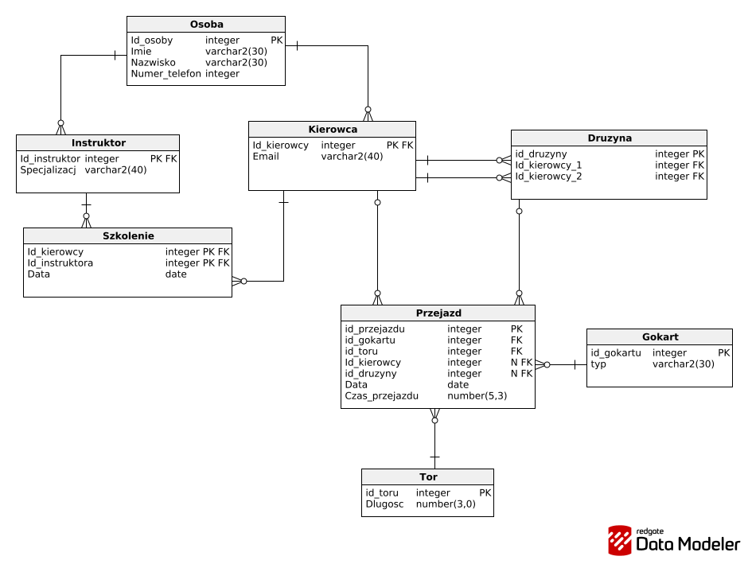

# Go-Kart Track Database (Oracle PL/SQL)

A relational database project built in Oracle SQL and PL/SQL to manage a go-kart track, including drivers, instructors, teams, tracks, karts, and race results.

## Features
- **Database Tables:** 8 connected tables (`Osoba`, `Kierowca`, `Instruktor`, `Druzyna`, `Gokart`, `Tor`, `Przejazd`, `Szkolenie`) with primary and foreign keys.
- **SQL Queries:** 10 queries to check driver rankings, track records, average lap times, and team results.
- **Stored Procedures:** Procedures using cursors to add new karts without duplicates and adjust lap times.
- **Triggers:** Automatic checks before inserting or updating data (validating lap times, checking driver/team rules, and formatting emails).

## Files
- `oracle_dml_ddl_select.sql` - creates tables, adds sample data, and runs 10 SQL queries
- `Proc_wyzw_oracle.sql` - PL/SQL procedures and triggers
- `Projekt_oracle.png` - database diagram (ERD)

## Database Diagram

